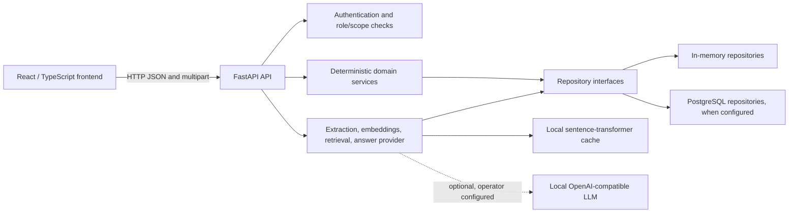

# UniMatch architecture

**Current implementation overview — submission-readiness audit**

This document describes the implementation present in the repository. It replaces
the earlier target architecture that described a Node.js/Express service. That
target included integrations and workflows that are not represented as delivered
functionality here.

## System boundary

UniMatch is a school-based decision-support application for South African Grade 11
and Grade 12 learners. Its deterministic APS and eligibility engine is authoritative.
The guidance assistant can explain retrieved university passages and display the
engine's learner-specific results; it must not recalculate or override them.

## Implemented application components

| Component | Current implementation |
|---|---|
| Frontend | React and TypeScript application, served/developed with Vite |
| API | Python 3.12, FastAPI, and Pydantic |
| Domain and services | APS, eligibility, learner, programme, and application rules in `src/unimatch/` |
| Persistence | In-memory repositories by default; SQLAlchemy PostgreSQL repositories selected when `DATABASE_URL` is configured |
| Schema evolution | Alembic migrations; migrations are not applied automatically |
| Authentication | API accounts, sessions, role checks, and school/university scoping are implemented in the current code |
| RAG | PDF/DOCX text extraction, chunking, pinned local embeddings, cosine retrieval, and answer providers in `src/unimatch/rag.py` |
| Applications | School-scoped application management and university-scoped review routes; payment and complete document prerequisites remain unintegrated |

## RAG request flow

1. A `UniversityAdmissions` account uploads a PDF or DOCX through the `/agent`
   interface. The API extracts selectable text, chunks it, embeds it with the pinned
   local model, and stores passages, vectors, and metadata under that university.
2. A `SchoolAdmin` asks a question through `/agent`. The API retrieves from sources
   associated with universities that have published programmes. If learner context
   is selected, the API verifies the learner belongs to that school and obtains
   deterministic APS and eligibility results from the existing services.
3. The default provider returns an extractive answer. If an operator configures a
   local OpenAI-compatible endpoint and model, the API can use the optional
   generative provider. Its source references are checked against passages supplied
   in that request; absent, malformed, or out-of-range citations cause the answer
   to be rejected.
4. The API stores conversation messages and source metadata in the configured
   repository. Conversations are scoped to their account and school.

## Application and admissions-review flow

The application API creates learner applications and validates status transitions.
`SchoolAdmin` users can manage applications for learners in their own school but
cannot make admissions decisions. University review is available through
`GET /api/university/applications`,
`GET /api/university/applications/{application_id}`, and
`PUT /api/university/applications/{application_id}/review`. The API derives the
university scope from the authenticated `UniversityAdmissions` account and the
programme's owning university; cross-university access is denied. Learners cannot
review applications. Review actions validate transitions and add reviewer
identity, timestamp, and note to status history.

The university review workflow is implemented, but ordinary submission remains
guarded. `Application.can_submit` requires a payment reference, linked documents,
programme-required document types when configured, an eligible application
status, and an unexpired deadline. There is no payment gateway, complete
application-document persistence/upload workflow, or document verification
integration. Review regression tests use a synthetic application seeded as
`Submitted` to isolate the review API; they do not prove the blocked submission
prerequisites or an end-to-end admission flow.

## Implementation and verification status

- **Implemented in code:** deterministic APS/eligibility services; API authentication
  and role/scope checks; React staff workflows; PDF/DOCX extraction; semantic
  embeddings and retrieval; extractive answers; optional local generation; citations;
  university-scoped application review; in-memory and PostgreSQL repository
  implementations; Alembic migration files.
- **Incomplete:** payment confirmation and full application-document storage and
  verification. The API rejects submission until its prerequisites are present and
  rejects unsupported manual payment-status changes.
- **Partially implemented:** uploaded originals are discarded after extraction.
  Extracted passages and vectors remain indexed until source deletion. Deleting a
  source removes it from future retrieval but does not remove historical conversation
  messages, their answer text, or cited passage snapshots. No retention expiry or
  approved original-file storage service is configured.
- **Unverified:** PostgreSQL integration and migration state, production deployment,
  local LLM server operation, and the complete deployed frontend-to-database flow.
  The latest recorded backend run skipped PostgreSQL tests because no approved
  isolated test database was available. Browser-based end-to-end and visual
  accessibility checks are also outstanding. Code and automated tests alone do
  not establish these runtime conditions.
- **Planned or external:** university admissions system integration, payment
  processing, email/SMS delivery, and other future integrations. They are outside
  the currently verified implementation boundary.

## Data isolation

University source operations are scoped to the signed-in university account. Chat
requires a school administrator; learner context and conversation reuse are checked
against that administrator's school and account. These controls are implemented in
API code and should also be covered by deployment-level security review before use
with real learner records.

## Persistence and deployment notes

With no `DATABASE_URL`, the API uses in-memory repositories and loses state on
restart. PostgreSQL repository implementations and migrations are present, but no
database is created or migrated automatically. Applying migrations and verifying
PostgreSQL persistence are separate deployment tasks. Semantic embeddings require
the pinned model revision to be provisioned in the local Hugging Face cache; API
runtime loading is local-only and does not download the model.
